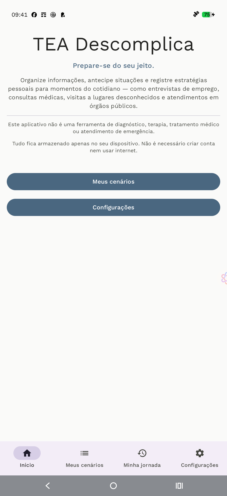
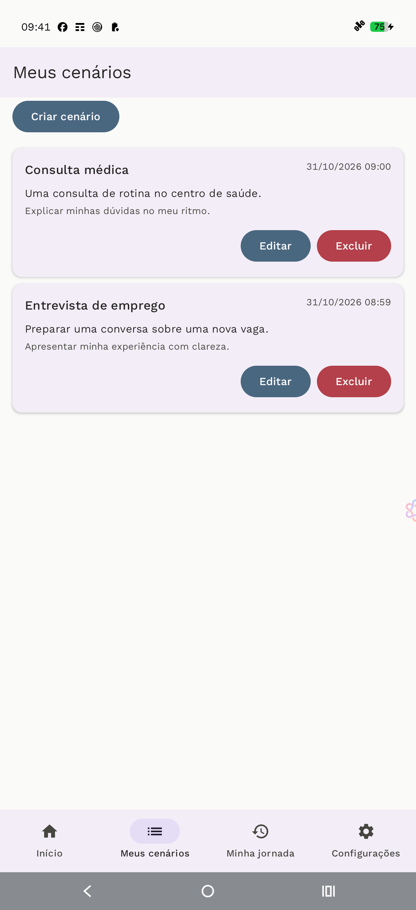

# TEA Descomplica

**Prepare situações, planeje alternativas e registre o que ajuda.**

`Kotlin · Jetpack Compose · Room`

[Reportar problema](https://github.com/alunoadsnoite/teadescomplica-public/issues) · [Licença](LICENSE) · [Privacidade](PRIVACY.md)

## Veja o aplicativo




**Prepare-se do seu jeito.**

Aplicativo Android para pessoas autistas que desejam se preparar para situações cotidianas, antecipar imprevistos e registrar estratégias pessoais. Funcionamento totalmente offline, sem conta, sem servidor, sem publicidade e com registros pessoais armazenados no aparelho.

## Objetivo

O TEA Descomplica ajuda a:
- Preparar entrevistas de emprego.
- Organizar informações para consultas médicas.
- Planejar visitas a lugares desconhecidos.
- Antecipar situações em órgãos públicos.
- Preparar alternativas quando algo não acontece como esperado.
- Registrar estratégias que ajudaram em experiências anteriores.

Este aplicativo **não é** uma ferramenta de diagnóstico, terapia, tratamento médico ou atendimento de emergência.

## Requisitos Inegociáveis

- Funcionamento totalmente offline.
- Nenhuma conta ou cadastro.
- Nenhum servidor ou backend.
- Nenhuma integração com inteligência artificial.
- Nenhuma publicidade.
- Nenhuma telemetria ou analytics.
- Nenhum SDK de rastreamento.
- Os registros ficam no aparelho. Você pode exportar uma cópia criptografada para um destino à sua escolha.
- Armazenamento local no dispositivo.
- Interface acessível e previsível.
- Código-fonte aberto (GPL-3.0-or-later).
- Sem permissão de internet no AndroidManifest.

## Arquitetura

- **Linguagem:** Kotlin
- **Interface:** Jetpack Compose + Material 3
- **Arquitetura:** MVVM + Repository + separação entre camadas
- **Persistência:** Room (SQLite local) + DataStore Preferences
- **Persistência de Backup:** Arquivo criptografado .teadbackup via Storage Access Framework (SAF)
- **Criptografia:** AES-256-GCM + PBKDF2-HMAC-SHA256
- **Injeção de dependências:** Manual (sem bibliotecas externas de DI)
- **Min SDK:** 26
- **Target SDK:** 34
- **Toolchain:** Java 17

## Estrutura de Diretórios

```
TEADescomplica/
├── app/
│   ├── build.gradle.kts
│   └── src/
│       ├── main/
│       │   ├── AndroidManifest.xml
│       │   └── java/br/com/teadescomplica/
│       │       ├── MainActivity.kt
│       │       ├── TeaDescomplicaApplication.kt
│       │       ├── core/
│       │       │   ├── database/
│       │       │   │   ├── migration/
│       │       │   │   ├── ScenarioEntity.kt
│       │       │   │   ├── ScenarioDao.kt
│       │       │   │   ├── ScenarioPreparationEntity.kt
│       │       │   │   ├── ScenarioPreparationDao.kt
│       │       │   │   ├── PossibleSituationEntity.kt
│       │       │   │   ├── PossibleSituationDao.kt
│       │       │   │   ├── AlternativePlanEntity.kt
│       │       │   │   ├── AlternativePlanDao.kt
│       │       │   │   ├── PersonalPhraseEntity.kt
│       │       │   │   ├── PersonalPhraseDao.kt
│       │       │   │   ├── PersonalExperienceEntity.kt
│       │       │   │   ├── PersonalExperienceDao.kt
│       │       │   │   ├── PersonalStrategyEntity.kt
│       │       │   │   ├── PersonalStrategyDao.kt
│       │       │   │   ├── ExperienceStrategyCrossRefEntity.kt
│       │       │   │   ├── ExperienceStrategyCrossRefDao.kt
│       │       │   │   └── AppDatabase.kt
│       │       │   ├── datastore/
│       │       │   ├── designsystem/
│       │       │   ├── navigation/
│       │       │   ├── di/
│       │       │   └── crypto/
│       │       │       ├── CryptoManager.kt
│       │       │       └── BackupFormat.kt
│       │       ├── data/
│       │       │   ├── local/
│       │       │   ├── mapper/
│       │       │   │   └── BackupSnapshotSerializer.kt
│       │       │   └── repository/
│       │       ├── domain/
│       │       │   ├── model/
│       │       │   ├── repository/
│       │       │   └── usecase/
│       │       └── feature/
│       │           ├── home/
│       │           ├── scenarios/
│       │           ├── journey/
│       │           └── settings/
│       │               ├── BackupViewModel.kt
│       │               ├── BackupRestoreScreen.kt
│       │               └── SettingsScreen.kt
│       │       └── res/
│       ├── test/
│       └── androidTest/
├── gradle/
│   └── libs.versions.toml
├── build.gradle.kts
├── settings.gradle.kts
├── gradle.properties
├── gradlew
├── gradlew.bat
├── README.md
├── LICENSE
├── CHANGELOG.md
├── PRIVACY.md
├── FDROID_READINESS.md
├── BACKUP_FORMAT.md
├── ETAPA_01_RELATORIO.md
├── ETAPA_02_RELATORIO.md
├── ETAPA_03_RELATORIO.md
└── ETAPA_04_RELATORIO.md
```

## Versões Utilizadas

| Componente | Versão |
|------------|--------|
| Android Gradle Plugin | 8.8.2 |
| Kotlin | 2.4.21 |
| Compose Compiler | 2.4.21 |
| Compose BOM | 2024.10.00 |
| Room | 2.5.2 |
| DataStore Preferences | 1.1.1 |
| Coroutines | 1.9.0 |
| Lifecycle | 2.7.0 |
| Activity Compose | 1.9.0 |
| Navigation Compose | 2.8.0 |
| JUnit | 4.13.2 |
| Gradle Wrapper | 8.10.2 |
| Java Toolchain | 17 |
| compileSdk / targetSdk | 34 |
| minSdk | 26 |
| Banco de dados | Versão 3 (migrações v1→v2, v2→v3) |
| Formato de backup | Versão 1 (.teadbackup) |
| Versão candidata | 1.1.1 (versionCode 3) |

## Compilação

```bash
./gradlew :app:assembleDebug
```

### Pré-requisitos

- Java 17 (Temurin recomendado)
- Android SDK com build-tools 34.0.0
- Gradle Wrapper (já incluído)

> **Limitação de execução:** Este ambiente não possui acesso ao repositório Maven do Google (`dl.google.com`), necessário para baixar algumas dependências do AndroidX Compose, Room e KSP. A compilação completa não pôde ser executada neste ambiente. O código-fonte está completo e estruturado para compilar em um ambiente com acesso aos repositórios padrão do Android.

## Telas Implementadas

1. **Início** — Apresentação do aplicativo, slogan, descrição, aviso médico, botões de navegação.
2. **Meus cenários** — Listagem, criação, edição e exclusão de cenários.
3. **Detalhes do cenário** — Preparação, situações possíveis, planos alternativos, frases pessoais.
4. **Modo de consulta** — Visualização simplificada somente leitura.
5. **Minha Jornada** — Lista de experiências com pesquisa, registro de novas experiências.
6. **Registro de experiência** — Formulário com título (obrigatório), data, descrição, o que ajudou, dificuldades, observações, estratégias, cenário relacionado.
7. **Detalhes da experiência** — Visualização completa com edit/delete e confirmação.
8. **Minhas Estratégias** — Biblioteca de estratégias pessoais com criar/editar/excluir/pesquisar.
9. **Configurações** — Tema (sistema/claro/escuro), reduzir animações, privacidade, versão, contato do desenvolvedor, backup e restauração.
10. **Backup e Restauração** — Criar backup criptografado, restaurar backup, escolher destino via SAF, definir senha.

## Privacidade

- `android:allowBackup="false"`
- Sem permissão `INTERNET`
- Regras de extração de dados (`data_extraction_rules.xml`) para Android 12+
- Dados armazenados exclusivamente localmente (Room SQLite privado)
- Sem telemetria, sem analytics, sem publicidade
- Backup criptografado com senha do usuário
- Senha não é armazenada em nenhum local
- Backup iniciado exclusivamente pelo usuário
- Exportação/restauração via Storage Access Framework (SAF)

## Contato do Desenvolvedor

Valdenor — valdenor.sa@proton.me

## Licença

GPL-3.0-or-later. Veja o arquivo LICENSE.

Copyright (C) 2026 Valdenor.

### Idioma

Em **Configurações → Idioma**, escolha Português (Brasil), English (US), Español ou o idioma do sistema. A preferência é salva no dispositivo. Em Android 13 ou posterior, ela também pode ser alterada nas configurações de idioma do aplicativo no sistema.

## Como contribuir

Sugestões, traduções e relatos de problemas são bem-vindos. Abra uma issue com o contexto e o comportamento esperado. Para alterações de código, explique a mudança e os testes realizados no pull request. Use dados fictícios nos exemplos e nas capturas.
